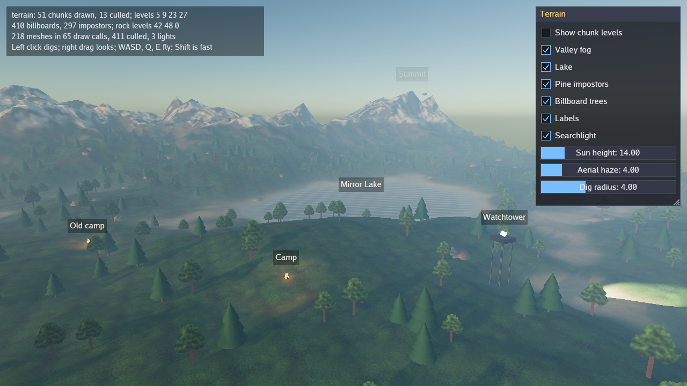
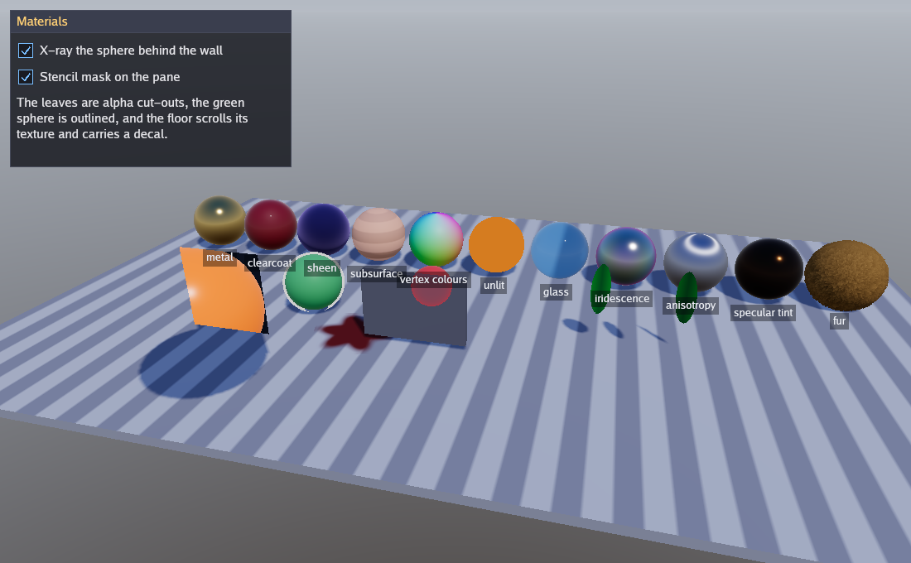
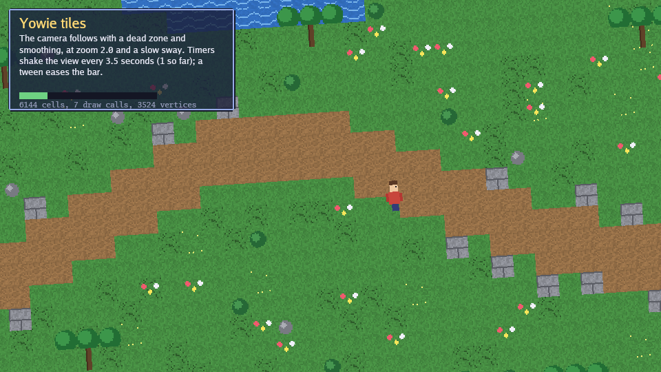
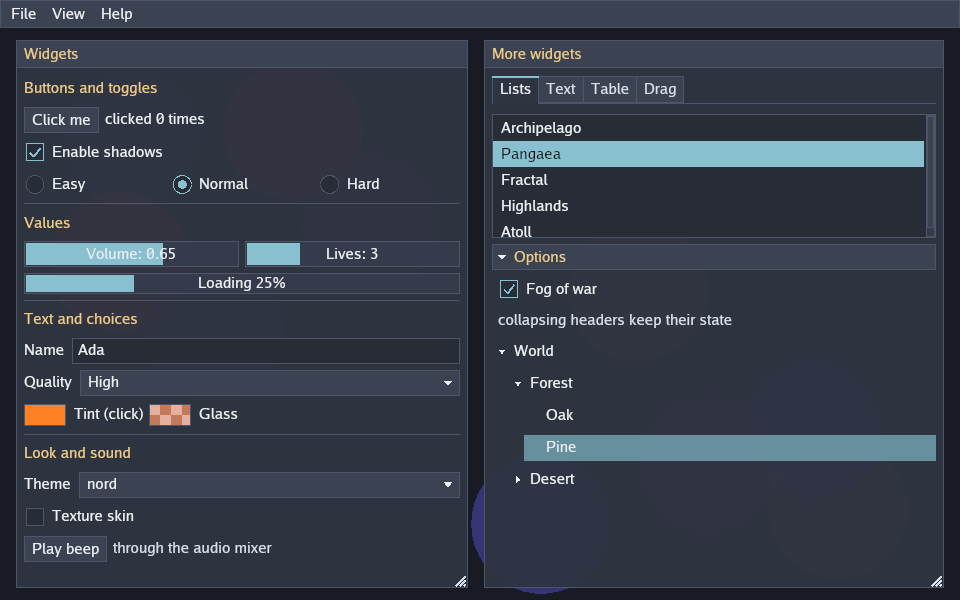

# Yowie

[](https://github.com/matjam/yowie/actions/workflows/ci.yml)

Yowie is a Rust game library for real-time and turn-based games that put
2D sprites and 3D models on one screen. One renderer draws sprites, text,
vector paths and tilemaps over physically based 3D scenes in the same
frame, and around it sit an entity component system, physics, animation,
audio, an immediate-mode interface, a debug console and the services a
finished game needs. It builds with plain `cargo` on Linux (native
Wayland, with X11 as the fallback), macOS and Windows.

| | |
|---|---|
|  |  |
|  |  |

## Features

- **Window and loop.** A fixed-step loop with interpolation, or a
  turn-based loop that sleeps until input. Time scale and pause, extra
  windows, cursor control, clipboard, input-method text, file drag and
  drop, and headless runs that write a screenshot.
- **Input.** Keys by physical position, mouse buttons, wheel and raw
  motion, up to four gamepads, and action maps with rebinding and
  two-axis composites.
- **2D graphics.** Sprites, shapes and nine-slices batched by texture,
  shader and blend mode; sprite sheets, atlases and Aseprite files;
  tilemaps on square, isometric and hexagonal grids; blob and Wang
  autotiling; Tiled maps; 2D cameras with follow, zoom and shake; render
  textures; 2D lights with shadows; game-written WGSL fragment shaders; a
  fixed virtual resolution with letterbox or integer scaling.
- **Text and vector paths.** Shaped text with right-to-left and mixed
  scripts, font fallback, hyphenation, markup, colour emoji, vertical
  text and distance-field glyphs. Vector paths with both fill rules, caps,
  joins, dashes, gradients and textured fills.
- **3D graphics.** Physically based materials with clearcoat, sheen,
  subsurface, glass, iridescence, anisotropy and fur; glTF models with
  skins and morph targets; up to 1024 clustered point and spot lights;
  cascaded and cube-map shadows; a procedural atmospheric sky,
  image-based lighting, reflection probes and a light probe grid; fog;
  terrain, water, billboards, impostors and levels of detail; static
  geometry culled on the GPU; decals, outlines, stencil masks,
  order-independent transparency, surface shaders and picking.
- **Post-processing.** Auto exposure, four tone curves, white balance and
  grading, LUTs, bloom, ambient occlusion, screen-space reflections,
  MSAA, FXAA and temporal antialiasing, depth of field, motion blur,
  light shafts and lens effects.
- **Animation.** Keyframe curves and clips for any value, players with
  crossfades and events, flipbooks, skeletons with layers, blend spaces,
  root motion, inverse kinematics and morph weights.
- **Particles.** Emitters described in JSON, simulated on the CPU or with
  compute shaders on the GPU, with presets for fire, smoke, sparks, rain
  and confetti.
- **Interface and console.** Immediate-mode widgets with layout, themes,
  skins, keyboard and gamepad navigation, drag and drop and an
  accessibility tree. An in-game console with commands, variables, key
  bindings, log capture and panels for timings, the GPU, input, entities,
  physics and audio.
- **Entities.** An entity component system over hecs with systems in
  stages, resources, events, parent and child hierarchy, transform
  propagation, saves, prefabs and scene documents.
- **Physics.** 2D and 3D rigid bodies on rapier with joints, sleeping,
  continuous collision, queries and character controllers; cloth, soft
  bodies and 2D fluids on the same colliders.
- **Audio.** A mixer with buses; streamed WAV, Ogg Vorbis, MP3 and FLAC;
  positional voices with panning or a binaural head model, Doppler and
  occlusion; reverb and reverb zones; microphone capture; tone synthesis;
  and a MOD, S3M, XM and IT player.
- **Services.** Asset directories and pack files with background loading
  and hot reload; JSON saves with migrations; translation with plural
  rules; seeded random numbers and dice; timers and cutscene sequences;
  tweens; grid pathfinding, field of view and flood fill; celestial
  mechanics; and networking over TCP with TLS and UDP with reliable
  channels, prediction, interpolation and snapshot deltas.

## Quick start

Yowie is not published on crates.io. Add it to your game's `Cargo.toml`
from the repository, with the profiles that keep debug builds fast enough
to play:

```toml
[dependencies]
yowie = { git = "https://github.com/matjam/yowie" }

[profile.dev]
opt-level = 1

[profile.dev.package."*"]
opt-level = 3
```

A complete game that moves an orange square with the arrow keys:

```rust,no_run
use yowie::gfx::{Sprite, Texture, TextureOptions};
use yowie::input::Key;
use yowie::{Color, Config, Context, Game, GameResult, vec2};

struct Demo {
    white: Texture,
    x: f32,
}

impl Game for Demo {
    fn init(ctx: &mut Context) -> GameResult<Self> {
        let white = Texture::from_pixels(&ctx.gfx, 1, 1, &[255; 4], TextureOptions::default())?;
        Ok(Demo { white, x: 100.0 })
    }

    fn update(&mut self, ctx: &mut Context) -> GameResult {
        if ctx.input.key_down(Key::Left) {
            self.x -= 200.0 * ctx.time.delta();
        }
        if ctx.input.key_down(Key::Right) {
            self.x += 200.0 * ctx.time.delta();
        }
        if ctx.input.key_pressed(Key::Escape) {
            ctx.quit();
        }
        Ok(())
    }

    fn draw(&mut self, ctx: &mut Context) -> GameResult {
        let sprite = Sprite::at(vec2(self.x, 100.0))
            .size(vec2(32.0, 32.0))
            .tint(Color::ORANGE);
        ctx.gfx.draw_sprite(&self.white, &sprite);
        Ok(())
    }
}

fn main() -> Result<(), yowie::Error> {
    yowie::run::<Demo>(Config::new("Demo"))
}
```

Run it with `cargo run`. The
[getting started guide](docs/guides/getting-started.md) explains each
part.

## Requirements

Yowie needs Rust 1.95 or later, installed with
[rustup](https://rustup.rs), and a GPU driver for Vulkan (Linux and
Windows), Metal (macOS) or DX12 (Windows). Every platform needs a C
compiler for the `zstd` and `ring` crates.

| Platform | System packages |
|---|---|
| macOS | The Xcode Command Line Tools (`xcode-select --install`). |
| Windows | The Visual Studio C++ build tools, which rustup offers to install. |
| Debian, Ubuntu | `build-essential pkg-config libasound2-dev libudev-dev libwayland-dev libxkbcommon-dev`, and a Vulkan driver (`mesa-vulkan-drivers` for AMD and Intel). |
| Fedora | `gcc pkgconf-pkg-config alsa-lib-devel systemd-devel wayland-devel libxkbcommon-devel`, and a Vulkan driver (`mesa-vulkan-drivers` for AMD and Intel). |

On Linux, ALSA is for audio (cpal), udev for gamepads (gilrs), and
Wayland and xkbcommon for the window and keyboard (winit). The window is
a native Wayland window under a Wayland session and an X11 window
otherwise. CI builds and tests on Ubuntu, macOS and Windows.

## Cargo features

Every feature is on by default.

| Feature | Turns on |
|---|---|
| `audio` | `yowie::audio`, `ctx.audio`, `Context::load_sound`, `Config::audio`, and the console's audio panel |
| `phys` | `yowie::phys`, the physics debug-line adapters (`phys::GfxDebugDraw` for 2D, `yowie::SceneDebugDraw` for a 3D scene), and the console's physics panels |
| `net` | `yowie::net` |
| `ui` | `yowie::ui` and `ctx.ui` |
| `console` | `yowie::console` and `ctx.console`, so that `Config::console` builds the console; turns on `ui` |
| `particle` | `yowie::particle` |
| `tiled` | `yowie::tiled` and `Context::load_map` |

To build only what a game uses, turn the defaults off and list the
features:

```toml
[dependencies]
yowie = { git = "https://github.com/matjam/yowie", default-features = false, features = ["audio", "ui"] }
```

The rest of Yowie (the loop, input, 2D and 3D graphics, ECS, animation,
assets, saves, translation, random numbers, timers, tweens, grids and
orbits) is always built.

## Examples

To run an example, clone the repository and use `cargo run --example
<name>`. Arguments for the example go after `--`.

| Example | Command | Shows |
|---|---|---|
| animation | `cargo run --example animation` | Keyframe clips on sprites and 3D transforms, a flipbook walker, crossfades, an animation event, two-bone IK and a clip mix on a slider, run by ECS systems. `--autoplay` presses the buttons by itself. |
| assets | `cargo run --example assets` | Background loading behind a progress bar, a pack file, hot reload of a file the example rewrites, packing on P, and a settings slot. `--dir <path>` picks the asset directory. |
| audio | `cargo run --example audio -- --binaural` | Three positional voices with Doppler and occlusion, panning or the binaural model, reverb, a low-pass filter, fades, pitch and voice priorities. `--zone`, `--music <file>`, `--mic`. |
| autotile | `cargo run --example autotile` | Painting terrain that picks its own tiles: blob grass, edge walls, Wang water and a hexagonal strip. |
| clear | `cargo run --example clear` | A window cleared to a colour that cycles through the hues. |
| gallery | `cargo run --example gallery -- --theme nord --skin` | Every interface widget, the themes, a texture skin, a particle editor that saves JSON, the overlay and the console. `--debug`, `--console`, `--panels`, `--beep`. |
| inputs | `cargo run --example inputs` | Everything the input state reports: keys, buttons, wheel, positions, raw motion with a locked cursor, typed text, four gamepads and an action map. |
| lighting | `cargo run --example lighting -- --effects taa,ssr,dof` | Skinned glTF creatures, cascaded and cube-map shadows, 160 clustered lights, an atmospheric sky up to orbit, image-based lighting, and every post effect on a panel. `--env <panorama>`, `--model <file>`, `--altitude <units>`, `--no-ui`. |
| materials | `cargo run --example materials` | Every material feature on a row of spheres, cut-out leaves, a scrolling texture, a decal, an outline, an x-ray tint and a stencil mask. `--env <panorama>`. |
| network | `cargo run --example network -- --listen :7777` | A chat room: lines over TCP, pointers over UDP, in a turn-based loop woken by the network threads. Join with `--join host:7777`; `--reliable`, `--name <n>`, `--bot`. |
| particles | `cargo run --example particles` | Fire, smoke, rain, sparks and confetti, a tuning panel, and a fountain simulated on the GPU. `--gpu` starts every effect on the GPU. |
| pathfinding | `cargo run --example pathfinding` | A*, a Dijkstra map, field of view and flood fill on a grid you paint, saved and loaded with F5 and F9. |
| physics2d | `cargo run --example physics2d` | Falling shapes, a kinematic paddle, a car on sprung wheel joints, a trigger zone and a sweeping ray cast. |
| physics3d | `cargo run --example physics3d` | Five hundred cubes of different materials stacked in a pen, and a ray cast from the pointer. |
| physics_lab | `cargo run --example physics_lab` | Capsules and hulls on mesh terrain, a hinge chain, a motorised wheel, a ragdoll and a character controller on stairs, driven from the console. `--exec "a; b"`. |
| probes | `cargo run --example probes -- --show-probes` | A reflection probe and a light probe grid in a room built as a static group. `--ssr`. |
| roguelike | `cargo run --example roguelike` | A turn-based dungeon crawl with field of view, chasing goblins and a message log; the process sleeps between moves. `--autoplay`. |
| shaders | `cargo run --example shaders` | Game fragment shaders, a compile error report, every blend mode, and a 3D surface shader; R reloads the shaders. |
| softbody | `cargo run --example softbody` | A cloth flag, a jelly cube you can kick and a tank of 2D fluid. `--kick <seconds>`. |
| solar | `cargo run --example solar -- --select Halcyon` | The ECS driving a scene document and prefabs, 400 instanced asteroids, picking, a render-texture minimap and system timings. `--timings`. |
| space | `cargo run --example space -- --warp 20` | A ship under thrust among planets and moons on Kepler orbits, with its predicted path. `--focus <name>`, `--dist <n>`, `--autoplay`. |
| sprites | `cargo run --example sprites -- --post` | 300 tinted, rotating sprites and a lit floor with shadow-casting crates. P toggles post-processing. |
| terrain | `cargo run --example terrain` | Chunked terrain with levels of detail, a lake, impostor and billboard trees, an atmospheric sky with mist, and labels in the world; left click digs. |
| tetris | `cargo run --example tetris` | The complete game the [Tetris guide](docs/guides/tetris.md) builds on the ECS. `--autoplay`. |
| text | `cargo run --example text` | Shaping, right-to-left text, fallback, wrapping, hyphenation, markup, colour emoji, vertical and distance-field text, and a hit-tested caret. `--font <file>`. |
| tiled | `cargo run --example tiled` | A Tiled map served from memory: layers, an external tileset, flipped tiles, an animated pond and object outlines. |
| tiles | `cargo run --example tiles` | A tilemap, a following camera with dead zone, zoom, rotation and shake, a walking animation, timers, tweens and a nine-slice HUD. |
| vector | `cargo run --example vector` | Vector paths: fill rules, curves, arcs, caps, joins, dashes, gradients, textured fills, blend modes and the transform stack. |
| viewer | `cargo run --example viewer` | A lit scene with an orbit camera, metal and plastic spheres, crossed translucent panes and an animated glTF creature. `--model <file.gltf\|file.glb>` shows a glTF file instead; `--sorted` blends the panes back to front. |
| window | `cargo run --example window` | Every window event as it arrives; F11 full screen, C locked cursor, T text input, N a second window. `--second-shot <png>`. |

Escape quits every example except `inputs`, where it releases a locked
cursor; close that window to quit.

## Running headless

The engine reads two flags and one environment variable in every Yowie
program, examples included:

| Flag | Effect |
|---|---|
| `--shot <file.png>` | Runs with no window, renders under the fixed clock, and writes the last frame. |
| `--seconds <n>` | Runs `n` seconds of game time, then exits. With `--shot`, renders that many seconds first. |
| `YOWIE_FIXED_CLOCK=1` | Advances time by one fixed step per frame, so a frame is the same picture on every machine. |

```bash
cargo run --example tetris -- --autoplay --seconds 12 --shot tetris.png
```

`cargo test --test examples` runs every example headless and compares
its frame with `examples/testdata/<name>.png` on the GPU the images were
recorded on. `YOWIE_UPDATE_GOLDEN=1` rewrites the images.

## Tools

| Tool | Does | Run |
|---|---|---|
| `yowie-info` | Prints the wgpu version and every GPU adapter with its backend, type, driver, features and limits, without opening a window. | `cargo run -p yowie-tools --bin yowie-info` |
| `yowie-tex` | Compresses PNG and JPEG images to BC1, BC3, BC4, BC5 or BC7 KTX2 files with a mip chain. | `cargo run -p yowie-tools --bin yowie-tex -- --format bc7 art/*.png` |
| `yowie-pack` | Writes an asset directory into one zstd-compressed pack file. | `cargo run -p yowie-asset --bin yowie-pack -- -o assets.pak assets` |
| `yowie-bundle` | Packages a built game as a `.app` on macOS or a folder elsewhere. It does not sign, notarize or cross-compile. | `cargo run -p yowie-tools --bin yowie-bundle -- --name "My Game" --exe target/release/my-game --assets assets.pak` |
| `yowie-play` | Plays a WAV, Ogg, MP3, FLAC, MOD, S3M, XM or IT file, or renders it to a WAV. | `cargo run -p yowie-tools --bin yowie-play -- song.xm` |

To install them for use outside the repository:

```bash
cargo install --git https://github.com/matjam/yowie yowie-tools yowie-asset
```

Options:

| Tool | Option | Meaning |
|---|---|---|
| `yowie-tex` | `-f`, `--format <bc1\|bc3\|bc4\|bc5\|bc7>` | Block format; `bc7` by default. |
| | `--linear`, `--srgb` | Whether the images hold data or sRGB colour (the default). Normal maps, masks and roughness maps want `--linear`. |
| | `-o`, `--output <file>`; `--outdir <dir>` | Where to write; by default each `.ktx2` goes beside its input. |
| | `--no-mips`, `--filter <box\|kaiser>`, `--fast`, `--straight-alpha`, `-v` | Skip the mip chain, pick the mip filter, use quicker BC7 settings, keep alpha straight, report sizes and times. |
| `yowie-pack` | `-o`, `--output <file>` | The pack to write; `assets.pak` by default. |
| | `--no-compress`, `--level <1-22>` | Store files uncompressed, or set the zstd level (19 by default). |
| `yowie-bundle` | `--name`, `--exe` | The game's display name and its built executable (both required). |
| | `--assets <dir or pack>`, `--icon <png>` | Assets to ship; a PNG for the macOS icon. |
| | `--id`, `--version-string` | The macOS bundle identifier and version (`1.0` by default). |
| | `-o`, `--output <dir>`, `--target <mac\|folder>` | The output directory (`dist` by default) and the layout (the host's by default). |
| `yowie-play` | `--dump <out.wav>`, `--seconds <n>` | Render offline to a 16-bit stereo WAV instead of playing; stop after `n` seconds. |

## Guides

The guides are in `docs/guides`. For the API reference, run
`cargo doc --open`.

**Start**

- [Introduction](docs/guides/introduction.md): what Yowie is, how it is put together, how a frame runs, and what to read next
- [Why Rust?](docs/guides/why-rust.md): what Rust gives a game library, which crates Yowie builds on, and the tradeoffs to plan for
- [Getting started](docs/guides/getting-started.md): install the toolchain and system packages, open a window, learn the loop and the window controls
- [API design](docs/guides/api-design.md): ownership, cleanup on drop, scoped state, builders and defaults, typed errors, units, threads and the context
- [Building Tetris](docs/guides/tetris.md): a complete game on the entity component system, step by step

**Engine**

- [The window](docs/guides/window.md): how the window is opened, sized and controlled, extra windows, and what is fixed at start and what changes at run time
- [Input](docs/guides/input.md): keys, mouse, gamepads, action maps and rebinding
- [Entities and systems](docs/guides/ecs.md): the entity component system, how it stores data, and how to structure a game around it
- [Game services](docs/guides/services.md): assets, saves, translation, random numbers, timers, tweens, grids and networking
- [The debug console](docs/guides/console.md): the in-game command line, its commands and variables, and the panels that show what the engine is doing

**Graphics**

- [2D graphics](docs/guides/graphics-2d.md): sprites, atlases, cameras, tilemaps, text, vector paths, particles, 2D lights and render targets
- [3D graphics](docs/guides/graphics-3d.md): cameras, meshes and models, materials, lights and shadows, sky and fog, culling and LOD, and post-processing for a 3D game
- [Shaders](docs/guides/shaders.md): WGSL authoring, engine preludes and hooks, uniforms, texture bindings and hot reload
- [Animation](docs/guides/animation.md): curves, clips and players for 2D and 3D, flipbooks, skeletons with crossfades, events, root motion, blend spaces, IK and morph targets
- [The interface](docs/guides/ui.md): immediate-mode widgets, layout, keyboard and gamepad navigation, drag and drop, themes and skins

**Audio**

- [Audio](docs/guides/audio.md): sounds, music, spatial voices, effects, capture and tracker music

**Simulation**

- [Physics](docs/guides/physics.md): rigid bodies in 2D and 3D, shapes, collisions, queries, joints and character controllers, and the cloth, soft bodies and fluids beside them
- [Orbits and space](docs/guides/space.md): celestial mechanics for any star system, Kepler orbits, N-body gravity and ships under thrust

## Developing

Before a commit, these pass:

```bash
cargo fmt --all
cargo clippy --workspace --all-targets -- -D warnings
cargo test --workspace
```

GPU tests create a headless device and skip with a message when the
machine has no GPU adapter. `CLAUDE.md` describes the repository layout
and rules.

## License

MIT. See [LICENSE](LICENSE).
