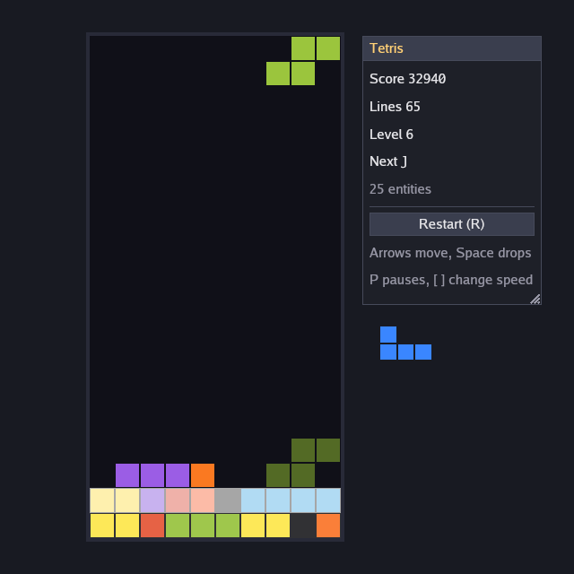

# Building Tetris

This guide builds a complete Tetris game on Yowie's entity component
system (ECS). It covers the window, the board, pieces and rotation,
components and resources, systems for input, gravity, locking, line
clears and scoring, then drawing, sound, pausing, game over and restart.

The full source is in `examples/tetris/`, in four files:

| File | What it holds |
|---|---|
| `model.rs` | The board, the pieces, the components, resources and events, and helper functions |
| `systems.rs` | The game rules as systems, and the schedule that orders them |
| `main.rs` | The `Game` impl: input in, drawing out, pause and restart |
| `autoplay.rs` | A computer player for `--autoplay` |

Every Rust block in this guide is copied from those files. The blocks
build on each other, so they do not compile one at a time; the example
itself compiles and runs. To play it, run:

```bash
cargo run --example tetris
```



The controls:

| Key | Action |
|---|---|
| Left, Right | Move the piece (held keys repeat) |
| Up | Rotate clockwise |
| Down | Soft drop, one row per press or repeat |
| Space | Hard drop |
| P | Pause and resume |
| `[`, `]` | Halve or double the game speed |
| R | Restart |
| Escape | Quit |

Read [getting started](getting-started.md) first for how to create a
project that depends on Yowie, and [entities and systems](ecs.md) for the
ECS in more depth than this guide needs.

## The project and the window

The game is one binary with three modules beside `main.rs`. In a project
of your own, put the files in `src/` and declare the modules at the top
of `src/main.rs`:

```rust,ignore
mod autoplay;
mod model;
mod systems;
```

To open the window, call `yowie::run` from `main` with a `Config`. The
window starts at 640 by 640 logical points with a dark background:

```rust,ignore
fn main() -> Result<(), yowie::Error> {
    let config = Config {
        clear_color: Color::rgb8(24, 26, 34),
        ..Config::new("Yowie Tetris").with_size(640, 640)
    };
    yowie::run::<Tetris>(config)
}
```

`yowie::run` builds the game with `Game::init`, then calls `update` at a
fixed rate (60 updates a second by default) and `draw` once per displayed
frame. It returns when the game calls `ctx.quit()` or the window closes.

The game type holds the ECS world, the schedule of systems, the optional
computer player and the rectangle of the score panel:

```rust,ignore
struct Tetris {
    world: World,
    schedule: Schedule,
    autoplay: Option<Autoplay>,
    panel: Rect,
}
```

The game's state lives in `world`. The `Tetris` struct holds only what
the ECS does not: the schedule, the computer player and the panel's
position.

## The board model

The board is ten cells wide and twenty tall. Row 0 is the top, so a
piece falls by adding to its `y`, which matches the 2D view, where +Y
points down:

```rust,ignore
/// The board is ten cells wide and twenty tall.
pub const COLS: usize = 10;
/// See [`COLS`].
pub const ROWS: usize = 20;
```

Each of the seven pieces is a name, a square grid of text where `#` is a
filled cell, and a colour. `Color::hex` takes an sRGB hex value and is a
`const fn`, so the table is a constant:

```rust,ignore
/// One kind of piece: its name, its shape as text (`#` is a filled cell)
/// and its colour.
pub struct Shape {
    pub name: &'static str,
    pub rows: &'static [&'static str],
    pub color: Color,
}

/// The seven pieces. The game rotates the shape, so each is listed once.
pub const SHAPES: [Shape; 7] = [
    Shape {
        name: "I",
        rows: &["....", "####", "....", "...."],
        color: Color::hex(0x5BC0EB),
    },
    Shape {
        name: "O",
        rows: &["##", "##"],
        color: Color::hex(0xFDE74C),
    },
    Shape {
        name: "T",
        rows: &[".#.", "###", "..."],
        color: Color::hex(0x9B5DE5),
    },
    Shape {
        name: "S",
        rows: &[".##", "##.", "..."],
        color: Color::hex(0x9BC53D),
    },
    Shape {
        name: "Z",
        rows: &["##.", ".##", "..."],
        color: Color::hex(0xE55934),
    },
    Shape {
        name: "J",
        rows: &["#..", "###", "..."],
        color: Color::hex(0x3A86FF),
    },
    Shape {
        name: "L",
        rows: &["..#", "###", "..."],
        color: Color::hex(0xFA7921),
    },
];
```

The grids are square (4 by 4 for I, 2 by 2 for O, 3 by 3 for the rest),
so a piece turns inside its own box.

## Pieces and rotation

The piece the player steers is a `Falling` value: the index of its shape,
its grid of cells as booleans, and the board position of the grid's
top-left corner. It is a component, as the next section explains.

```rust,ignore
/// The piece the player steers. There is one at a time.
#[derive(Clone, Debug, PartialEq)]
pub struct Falling {
    pub kind: usize,
    /// `cells[y][x]` is true where the piece has a block.
    pub cells: Vec<Vec<bool>>,
    pub x: i32,
    pub y: i32,
}
```

To build a piece, `new_falling` parses the text rows into booleans and
centres the grid at the top of the board:

```rust,ignore
/// Builds a piece at the top of the board.
pub fn new_falling(kind: usize) -> Falling {
    let rows = SHAPES[kind].rows;
    Falling {
        kind,
        cells: rows
            .iter()
            .map(|r| r.chars().map(|c| c == '#').collect())
            .collect(),
        x: (COLS - rows[0].len()) as i32 / 2,
        y: 0,
    }
}
```

The methods on `Falling` return new values instead of changing the piece
in place. A system can then test a candidate position and keep it only if
it fits. `rotated` turns the grid clockwise: cell `(x, y)` of the result
is cell `(y, n - 1 - x)` of the original. `blocks` lists the board cells
the piece covers, and `moved` shifts the piece:

```rust,ignore
impl Falling {
    /// The piece turned clockwise: transpose and flip over a square grid.
    pub fn rotated(&self) -> Falling {
        let n = self.cells.len();
        let cells = (0..n)
            .map(|y| (0..n).map(|x| self.cells[n - 1 - x][y]).collect())
            .collect();
        Falling {
            cells,
            ..self.clone()
        }
    }

    /// The board cells the piece covers.
    pub fn blocks(&self) -> impl Iterator<Item = (i32, i32)> + '_ {
        self.cells.iter().enumerate().flat_map(move |(y, row)| {
            row.iter()
                .enumerate()
                .filter(|(_, on)| **on)
                .map(move |(x, _)| (self.x + x as i32, self.y + y as i32))
        })
    }

    /// The piece moved by `(dx, dy)`.
    pub fn moved(&self, dx: i32, dy: i32) -> Falling {
        Falling {
            x: self.x + dx,
            y: self.y + dy,
            ..self.clone()
        }
    }
}
```

Two functions answer every collision question. `fits` checks that each
block is inside the walls, above the floor and on an empty cell. Blocks
above the top row (`y < 0`) are allowed, so a piece can turn near the
top. `landing` moves the piece down until the next row would not fit,
which gives the hard-drop position and the ghost piece:

```rust,ignore
/// Whether the piece stays inside the walls and floor and off the stack.
pub fn fits(board: &Board, piece: &Falling) -> bool {
    piece.blocks().all(|(x, y)| {
        (0..COLS as i32).contains(&x)
            && y < ROWS as i32
            && (y < 0 || !board.full[y as usize][x as usize])
    })
}

/// Where the piece would land if it dropped now.
pub fn landing(board: &Board, piece: &Falling) -> Falling {
    let mut p = piece.clone();
    while fits(board, &p.moved(0, 1)) {
        p = p.moved(0, 1);
    }
    p
}
```

## Components, resources and events

The ECS stores three kinds of data, and the game uses all three.

**Components** are data attached to entities. A Yowie `World`
dereferences to a `hecs::World`, so any `'static` type that is `Send` and
`Sync` is a component, with no derive or registration. Tetris has three:
a settled block (`Cell`), the falling piece (`Falling`, above) and a
fading white wash over a cleared row (`RowFlash`). Each settled block is
its own entity, so clearing a row despawns ten entities.

```rust,ignore
/// One settled block on the board.
#[derive(Clone, Copy, Debug)]
pub struct Cell {
    pub x: i32,
    pub y: i32,
    pub kind: usize,
}
```

```rust,ignore
/// A white wash over one board row that fades out; a tween drives it.
pub struct RowFlash {
    pub row: i32,
    pub fade: Tween<f32>,
}
```

**Resources** are values the world holds one of per type. Insert one with
`World::insert_resource` and read it with `World::resource` or
`World::resource_mut`, which return an `Option`. `Board` is the
occupancy grid. It duplicates what the `Cell` entities say, so the
collision tests read an array instead of querying entities:

```rust,ignore
/// Which board cells are occupied. The `board` system rebuilds it from the
/// [`Cell`] entities so the other systems test collisions against an array.
#[derive(Clone, Copy)]
pub struct Board {
    pub full: [[bool; COLS]; ROWS],
}

impl Default for Board {
    fn default() -> Self {
        Board {
            full: [[false; COLS]; ROWS],
        }
    }
}

/// What the score panel shows.
#[derive(Clone, Copy, Debug, Default)]
pub struct Score {
    pub points: u32,
    pub lines: u32,
    pub level: u32,
    pub over: bool,
}
```

Input and time are resources too. `update` copies the keys and the
update's length into them, so every system is a function of the world
alone. A system that reads only the world can be driven by the keyboard,
by the computer player or by a test in the same way.

```rust,ignore
/// The keys pressed this update, copied from the engine's input state so the
/// systems read only the world.
#[derive(Clone, Copy, Debug, Default)]
pub struct Controls {
    pub left: bool,
    pub right: bool,
    pub rotate: bool,
    pub down: bool,
    pub drop: bool,
}

/// Seconds the current update covers, copied from `ctx.time`.
pub struct Dt(pub f32);
```

Gravity and the lock delay run on `yowie::timer::Timers`, a set of timers
that each carry a value of your choosing (here a `Tick`) and report it
when they fire. The `Clock` resource holds the timers and the ids of the
two that the systems cancel and replace. `Bag` deals the pieces from a
seeded `yowie::rng::Rng` and remembers the next one for the preview:

```rust,ignore
/// What a timer in [`Clock`] means when it fires.
#[derive(Clone, Copy, Debug, PartialEq, Eq)]
pub enum Tick {
    /// The piece falls one row.
    Gravity,
    /// A piece that rested on the stack for the lock delay settles.
    Lock,
}

/// Gravity and lock delay run on game time, so pausing or slowing the game
/// slows them too.
pub struct Clock {
    pub timers: Timers<Tick>,
    pub gravity: TimerId,
    /// Running while the piece rests on something.
    pub lock: Option<TimerId>,
}

/// Deals the pieces.
pub struct Bag {
    pub rng: Rng,
    pub next: usize,
}
```

**Events** are how one system tells another that something happened. To
send one, call `World::send_event`. To read them, call
`World::read_events::<T>()`. An event stays readable during the update
that sent it and the next one, because the schedule rotates the event
queues after its last stage. Tetris sends four events of its own:

```rust,ignore
/// Asks the `lock` system to settle the falling piece.
#[derive(Clone)]
pub struct LockPiece;
/// A piece settled.
#[derive(Clone)]
pub struct Locked;
/// Rows were removed.
#[derive(Clone)]
pub struct Cleared {
    pub rows: Vec<i32>,
}
/// The stack reached the top.
#[derive(Clone)]
pub struct GameOver;
```

Because events stay readable for two updates, a system that reads an
event every update would see it twice. The `take_events` helper reads the
events and clears them with `World::clear_events`, so each one is handled
once. Three more helpers keep the systems short. `res` and `res_mut`
fetch a resource that the game always inserts, and `falling` returns the
falling piece and its entity:

```rust,ignore
/// A resource the game inserted when it started.
pub fn res<T: 'static>(world: &World) -> &T {
    world
        .resource::<T>()
        .expect("Tetris::reset inserts every resource before the schedule runs")
}

/// See [`res`].
pub fn res_mut<T: 'static>(world: &mut World) -> &mut T {
    world
        .resource_mut::<T>()
        .expect("Tetris::reset inserts every resource before the schedule runs")
}

/// The falling piece and its entity, if there is one.
pub fn falling(world: &World) -> Option<(Entity, Falling)> {
    world
        .query::<(Entity, &Falling)>()
        .iter()
        .next()
        .map(|(e, p)| (e, p.clone()))
}

/// Reads the events of type `T` and clears them, so a system that runs on
/// the next update does not see them again (events stay readable for two
/// updates).
pub fn take_events<T: Clone + 'static>(world: &mut World) -> Vec<T> {
    let events = world.read_events::<T>().cloned().collect();
    world.clear_events::<T>();
    events
}
```

`falling` clones the piece out of the query. A system can then change
the world (spawn, despawn, send events) while it works on the copy, and
write the result back with `world.get::<&mut Falling>(entity)`.

## Starting and restarting

To start a game, `reset` despawns every entity with `World::clear` and
inserts every resource fresh. `insert_resource` replaces a resource of
the same type, so a restart runs the same code as the first start. The
random number generator has a fixed seed, so every game deals the same
pieces. Gravity starts as a repeating timer:

```rust,ignore
    /// Clears the board and deals the first piece: every resource is
    /// inserted fresh, so a restart is the same code as a start.
    fn reset(&mut self) {
        let w = &mut self.world;
        w.clear();
        w.insert_resource(Board::default());
        w.insert_resource(Score::default());
        w.insert_resource(Controls::default());
        w.insert_resource(Dt(0.0));
        let mut rng = Rng::new(7);
        let next = rng.below(SHAPES.len() as u64) as usize;
        w.insert_resource(Bag { rng, next });
        let mut timers = Timers::new();
        let gravity = timers.every(gravity_interval(0), Tick::Gravity);
        w.insert_resource(Clock {
            timers,
            gravity,
            lock: None,
        });
        // The first piece comes from the `spawn` system on the first update.
        rebuild_board(w);
        self.autoplay = self.autoplay.as_ref().map(|_| Autoplay::default());
    }
```

`World::clear` despawns entities only. Resources stay until they are
replaced or removed with `World::remove_resource`.

## The schedule

The rules are systems. A system is any `FnMut(&mut World)`, so a plain
`fn` or a closure works. To run systems in order, add them to a
`yowie::ecs::Schedule`. `System::new` names a system, `after` and
`before` order it against another system or a set, `in_set` puts it in a
named set, and `run_if` adds a condition checked each time the schedule
reaches it:

```rust,ignore
/// Builds the schedule.
///
/// Systems are named, and `before` and `after` say which must run first
/// within a stage. The order they are added in does not matter, so the
/// effects system can be listed first and still run last. The rules share
/// a set, `rules`, so that one `after("rules")` covers all of them.
pub fn schedule(effects: Effects) -> Schedule {
    let mut s = Schedule::new();
    s.add(
        Stage::Update,
        System::new("effects", effects_system(effects)).after("rules"),
    );
    s.add(
        Stage::Update,
        System::new("board", rebuild_board_system).in_set("rules"),
    );
    s.add(
        Stage::Update,
        System::new("input", input)
            .in_set("rules")
            .after("board")
            .run_if(playing),
    );
    s.add(
        Stage::Update,
        System::new("lock-delay", lock_delay)
            .in_set("rules")
            .after("input")
            .run_if(playing),
    );
    s.add(
        Stage::Update,
        System::new("gravity", gravity)
            .in_set("rules")
            .after("lock-delay")
            .run_if(playing),
    );
    s.add(
        Stage::Update,
        System::new("lock", lock).in_set("rules").after("gravity"),
    );
    s.add(
        Stage::Update,
        System::new("clear-lines", clear_lines)
            .in_set("rules")
            .after("lock"),
    );
    s.add(
        Stage::Update,
        System::new("spawn", spawn)
            .in_set("rules")
            .after("clear-lines")
            .run_if(playing),
    );
    s
}
```

Each update therefore runs `board`, `input`, `lock-delay`, `gravity`,
`lock`, `clear-lines` and `spawn`, then `effects`. The ordering
constraints apply within one stage. A schedule has four stages, which run
in the order `Stage::Startup` (first run only), `Stage::PreUpdate`,
`Stage::Update` and `Stage::PostUpdate`. Tetris uses only
`Stage::Update`. After every system the schedule applies the commands
queued with `World::commands`.

The run condition `playing` stops the rules that move pieces once the
game is over:

```rust,ignore
/// Run condition: the game is not over.
fn playing(world: &World) -> bool {
    !res::<Score>(world).over
}
```

`Game::init` builds the schedule and calls `Schedule::validate`. It
returns an error when an `after` or `before` names no system or set, or
when the constraints form a cycle. Without it, `Schedule::run` logs the
error and runs that stage in the order the systems were added.

```rust,ignore
        let schedule = systems::schedule(effects);
        let mut schedule = schedule;
        // Fail at start-up, not mid-game, if the ordering is wrong.
        schedule.validate()?;
```

## Input as a resource

Each update, `Game::update` fills the `Controls` and `Dt` resources and
runs the schedule once:

```rust,ignore
    fn update(&mut self, ctx: &mut Context) -> GameResult {
        if ctx.input.key_pressed(Key::Escape) {
            ctx.quit();
        }
        if ctx.input.key_pressed(Key::R) {
            self.reset();
        }
        // Input becomes a resource so the systems stay functions of the
        // world alone.
        let controls = match &mut self.autoplay {
            Some(player) => player.controls(&self.world),
            None => Self::read_keys(ctx),
        };
        *res_mut::<Controls>(&mut self.world) = controls;
        res_mut::<Dt>(&mut self.world).0 = ctx.time.delta();
        self.schedule.run(&mut self.world);
        Ok(())
    }
```

`read_keys` turns the keyboard into `Controls`.
`InputState::key_pressed` is true when the key went down since the
previous update. `InputState::key_repeated` is true when the operating system sent an
auto-repeat since the previous update, so testing both moves the piece
once on the press and again on each repeat while the key is held:

```rust,ignore
    /// The keys held this update, as the systems read them.
    fn read_keys(ctx: &Context) -> Controls {
        let i = &ctx.input;
        let key = |k| i.key_pressed(k) || i.key_repeated(k);
        Controls {
            left: key(Key::Left),
            right: key(Key::Right),
            rotate: i.key_pressed(Key::Up),
            down: key(Key::Down),
            drop: i.key_pressed(Key::Space),
        }
    }
```

The `board` system runs first and rebuilds the `Board` resource from the
`Cell` entities. `rebuild_board` is also called directly from `reset` and
`clear_lines`, so it is a plain function with a system wrapper:

```rust,ignore
/// Rebuilds the occupancy grid from the [`Cell`] entities.
pub fn rebuild_board(world: &mut World) {
    let mut board = Board::default();
    for c in world.query::<&Cell>().iter() {
        if (0..ROWS as i32).contains(&c.y) && (0..COLS as i32).contains(&c.x) {
            board.full[c.y as usize][c.x as usize] = true;
        }
    }
    *res_mut::<Board>(world) = board;
}

fn rebuild_board_system(world: &mut World) {
    rebuild_board(world);
}
```

The `input` system applies the controls to a copy of the falling piece
and writes the copy back. Each move goes through `attempt`, which keeps a
candidate only if it fits. Rotation tries the turned piece in place, then
one and two cells to each side (a wall kick), so a piece next to a wall
can still turn. A soft drop scores one point per row and a hard drop two,
and a hard drop sends `LockPiece` so the piece settles in this update:

```rust,ignore
/// Moves `piece` to `candidate` if it fits.
fn attempt(board: &Board, piece: &mut Falling, candidate: Falling) -> bool {
    let ok = fits(board, &candidate);
    if ok {
        *piece = candidate;
    }
    ok
}

/// Moves `piece` by `(dx, dy)` if the new place is free.
fn shift(board: &Board, piece: &mut Falling, dx: i32, dy: i32) -> bool {
    let candidate = piece.moved(dx, dy);
    attempt(board, piece, candidate)
}

/// Applies the [`Controls`] to the falling piece.
fn input(world: &mut World) {
    let controls = *res::<Controls>(world);
    let board = *res::<Board>(world);
    let Some((entity, mut piece)) = falling(world) else {
        return;
    };
    let mut points = 0;
    if controls.left {
        shift(&board, &mut piece, -1, 0);
    }
    if controls.right {
        shift(&board, &mut piece, 1, 0);
    }
    if controls.rotate {
        let turned = piece.rotated();
        // Wall kick: nudge sideways when the turn would clip a wall.
        let turned_ok = [0, -1, 1, -2, 2]
            .into_iter()
            .any(|dx| attempt(&board, &mut piece, turned.moved(dx, 0)));
        if turned_ok {
            world.send_event(Rotated);
        }
    }
    if controls.down && shift(&board, &mut piece, 0, 1) {
        points += 1;
    }
    if controls.drop {
        let landed = landing(&board, &piece);
        points += 2 * (landed.y - piece.y) as u32;
        piece = landed;
        world.send_event(LockPiece);
    }
    if let Ok(mut stored) = world.get::<&mut Falling>(entity) {
        *stored = piece;
    }
    res_mut::<Score>(world).points += points;
}
```

`Board` and `Controls` are `Copy`, so the system copies them out of the
world first. It can then borrow the world mutably to send events and
write the piece back.

## Gravity and the lock delay

The piece falls one row each time the gravity timer fires. The interval
starts at 0.6 seconds and shrinks by 15% per level, down to 0.08 seconds:

```rust,ignore
/// Seconds a resting piece may still be moved before it locks.
const LOCK_DELAY: f64 = 0.5;
/// Points for clearing 0 to 4 rows at once, before the level bonus.
const LINE_POINTS: [u32; 5] = [0, 100, 300, 500, 800];
/// Rows to clear for each level.
const LINES_PER_LEVEL: u32 = 10;

/// Seconds between gravity steps at `level`.
pub fn gravity_interval(level: u32) -> f64 {
    (0.6 * 0.85_f64.powi(level as i32)).max(0.08)
}
```

A piece that lands does not settle at once. The `lock-delay` system
starts a one-shot timer with `Timers::after` when the piece rests on
something, and cancels it with `Timers::cancel` when the piece can fall
again (after the player slides it off a ledge). The player has half a
second to move a resting piece:

```rust,ignore
/// Starts the lock timer when the piece rests on something and cancels it
/// when the piece can fall again, so a piece may slide a little before it
/// settles.
fn lock_delay(world: &mut World) {
    let Some((_, piece)) = falling(world) else {
        return;
    };
    let resting = !fits(res::<Board>(world), &piece.moved(0, 1));
    let clock = res_mut::<Clock>(world);
    match (resting, clock.lock) {
        (true, None) => clock.lock = Some(clock.timers.after(LOCK_DELAY, Tick::Lock)),
        (false, Some(id)) => {
            clock.timers.cancel(id);
            clock.lock = None;
        }
        _ => {}
    }
}
```

The `gravity` system advances every timer by the update's game time.
`Timers::update` returns the timers that fired, in the order they fired,
each with the value it was created with in `data`. A gravity tick moves
the piece down when it fits. A lock tick sends `LockPiece`:

```rust,ignore
/// Advances the clock by the update's game time and reacts to the timers
/// that fired.
fn gravity(world: &mut World) {
    let dt = f64::from(res::<Dt>(world).0);
    let fired = res_mut::<Clock>(world).timers.update(dt);
    for f in fired {
        match f.data {
            Tick::Gravity => {
                let board = *res::<Board>(world);
                if let Some((entity, piece)) = falling(world)
                    && fits(&board, &piece.moved(0, 1))
                    && let Ok(mut stored) = world.get::<&mut Falling>(entity)
                {
                    stored.y += 1;
                }
            }
            Tick::Lock => {
                res_mut::<Clock>(world).lock = None;
                world.send_event(LockPiece);
            }
        }
    }
}
```

The timers advance by `Dt`, which `update` copies from
`ctx.time.delta()`. Pausing the game or changing the time scale therefore
changes how fast pieces fall, with no extra code. See
[game services](services.md) for timers, tweens and random numbers.

## Locking

The `lock` system runs when something sent `LockPiece`: a hard drop or
the lock timer. It turns each block of the falling piece into a `Cell`
entity, despawns the `Falling` entity, cancels a lock timer that is still
running, and sends `Locked`. Blocks above the top row are dropped.

```rust,ignore
/// Turns the falling piece into [`Cell`] entities when something asked
/// for it.
fn lock(world: &mut World) {
    if take_events::<LockPiece>(world).is_empty() {
        return;
    }
    let Some((entity, piece)) = falling(world) else {
        return;
    };
    for (x, y) in piece.blocks().filter(|(_, y)| *y >= 0) {
        world.spawn((Cell {
            x,
            y,
            kind: piece.kind,
        },));
    }
    // A missing entity means the piece is already gone.
    let _ = world.despawn(entity);
    let clock = res_mut::<Clock>(world);
    if let Some(id) = clock.lock.take() {
        clock.timers.cancel(id);
    }
    world.send_event(Locked);
}
```

`World::spawn` takes a tuple of components and returns the new `Entity`.
`World::despawn` returns an error for an entity that no longer exists; it
also despawns the entity's children, which Tetris does not use.

## Line clears and scoring

The `clear-lines` system rebuilds the board, finds the full rows and
returns early when there are none. Otherwise it walks every `Cell` with
`World::query_mut`. Cells on a full row are collected for despawning, and
every other cell moves down one row for each cleared row below it. The
entities are despawned after the query ends, because a query holds a
borrow of the world.

```rust,ignore
/// Removes full rows, lets the cells above fall, and scores them.
fn clear_lines(world: &mut World) {
    rebuild_board(world);
    let board = *res::<Board>(world);
    let full: Vec<i32> = (0..ROWS)
        .filter(|y| board.full[*y].iter().all(|c| *c))
        .map(|y| y as i32)
        .collect();
    if full.is_empty() {
        return;
    }
    let mut doomed = Vec::new();
    for (entity, cell) in world.query_mut::<(Entity, &mut Cell)>() {
        if full.contains(&cell.y) {
            doomed.push(entity);
        } else {
            // Each cleared row below the cell moves it down one.
            cell.y += full.iter().filter(|row| **row > cell.y).count() as i32;
        }
    }
    for entity in doomed {
        let _ = world.despawn(entity);
    }
    rebuild_board(world);

    let score = res_mut::<Score>(world);
    score.points += LINE_POINTS[full.len().min(4)] * (score.level + 1);
    score.lines += full.len() as u32;
    let level = score.lines / LINES_PER_LEVEL;
    if level != score.level {
        score.level = level;
        // A new level replaces the gravity timer with a faster one.
        let clock = res_mut::<Clock>(world);
        clock.timers.cancel(clock.gravity);
        clock.gravity = clock.timers.every(gravity_interval(level), Tick::Gravity);
    }
    world.send_event(Cleared { rows: full });
}
```

Clearing 1, 2, 3 or 4 rows at once scores 100, 300, 500 or 800 points,
times the level plus one. Every ten rows raise the level. A new level
cancels the gravity timer and starts a faster one, and stores its id in
`Clock` for the next change.

## Spawning and game over

The `spawn` system deals a piece when there is no falling piece: on the
first update, and after each lock. It takes the piece the preview showed,
draws the next one from the bag, and spawns the new piece. When the new
piece does not fit, the stack has reached the top. The system sets
`Score::over` and sends `GameOver`. From the next update on, the
`playing` condition stops the rules that move pieces.

```rust,ignore
/// Deals the next piece. If it does not fit the game is over.
fn spawn(world: &mut World) {
    if falling(world).is_some() {
        return;
    }
    let bag = res_mut::<Bag>(world);
    let kind = bag.next;
    bag.next = bag.rng.below(SHAPES.len() as u64) as usize;
    let piece = new_falling(kind);
    if !fits(res::<Board>(world), &piece) {
        res_mut::<Score>(world).over = true;
        world.send_event(GameOver);
    }
    world.spawn((piece,));
}
```

`Rng::below(n)` returns a number from 0 up to, but not including, `n`.

## Sound

The game makes its sounds at start-up instead of loading files.
`Pcm::sine` builds a mono sine tone with 10 ms fades at both ends, and
`Mixer::sound` converts PCM to a `Sound` at the mixer's sample rate.
`ctx.audio` is the engine's `Mixer`; cloning it gives another handle to
the same mixer, which the `effects` system keeps:

```rust,ignore
    fn init(ctx: &mut Context) -> GameResult<Self> {
        let mixer = ctx.audio.clone();
        let rate = mixer.rate();
        let tone = |hz: f64, seconds: f64| mixer.sound(&Pcm::sine(hz, seconds, rate));
        let effects = Effects {
            lock: tone(220.0, 0.06)?,
            clear: tone(660.0, 0.25)?,
            rotate: tone(440.0, 0.03)?,
            over: tone(110.0, 0.6)?,
            mixer: mixer.clone(),
        };
```

```rust,ignore
/// The sounds and the mixer the effects system plays them on.
pub struct Effects {
    pub mixer: Mixer,
    pub lock: Sound,
    pub clear: Sound,
    pub rotate: Sound,
    pub over: Sound,
}

/// Asks `lock` to settle the piece the player turned; the `effects` system
/// plays the click.
#[derive(Clone)]
pub struct Rotated;
```

The `effects` system is a closure that owns the `Effects`, so the sounds
need no resource. It runs after every rule, so it sees the events they
sent in the same update. To play a sound, it calls `Mixer::play` with
`PlayOptions`; `volume` is a gain and `pitch` a playback speed, so the
clear sound rises with the number of rows. For each cleared row it also
spawns a `RowFlash` entity whose tween fades from 1 to 0 over 0.4
seconds. Each update it advances the tweens by `Dt` and despawns the
flashes that are done.

```rust,ignore
/// Turns events into sound and into the row flashes tweens drive. It runs
/// after every rule, so it sees what they sent in the same update.
fn effects_system(fx: Effects) -> impl FnMut(&mut World) {
    move |world| {
        let play = |sound: &Sound, volume: f32, pitch: f32| {
            fx.mixer.play(
                sound,
                PlayOptions {
                    volume,
                    pitch,
                    ..PlayOptions::default()
                },
            );
        };
        for _ in take_events::<Rotated>(world) {
            play(&fx.rotate, 0.25, 1.0);
        }
        for _ in take_events::<Locked>(world) {
            play(&fx.lock, 0.4, 1.0);
        }
        for cleared in take_events::<Cleared>(world) {
            play(&fx.clear, 0.5, 1.0 + 0.2 * cleared.rows.len() as f32);
            for row in cleared.rows {
                world.spawn((RowFlash {
                    row,
                    fade: Tween::new(1.0, 0.0, 0.4).ease(Ease::Out(Curve::Quad)),
                },));
            }
        }
        for _ in take_events::<GameOver>(world) {
            play(&fx.over, 0.5, 1.0);
        }

        // The flashes fade on game time and remove themselves when done.
        let dt = res::<Dt>(world).0;
        let mut finished = Vec::new();
        for (entity, flash) in world.query_mut::<(Entity, &mut RowFlash)>() {
            flash.fade.update(dt);
            if flash.fade.done() {
                finished.push(entity);
            }
        }
        for entity in finished {
            let _ = world.despawn(entity);
        }
    }
}
```

A run with no audio device, with audio turned off, or headless (with
`--shot`) gets an offline mixer, so the same code runs and the voices
finish as they would with a device. See [audio](audio.md) for streamed
music, buses and spatial sound.

## Drawing

`Game::draw` reads the world and queues 2D shapes; it changes nothing in
the world. It first works out where the board goes. 2D drawing is in view
units with the origin at the top-left, and the board is centred in the
window, shifted 80 units left to leave room for the panel:

```rust,ignore
    fn draw(&mut self, ctx: &mut Context) -> GameResult {
        let size = ctx.gfx.view_size();
        let origin = vec2(
            (size.x - COLS as f32 * CELL) / 2.0 - 80.0,
            (size.y - ROWS as f32 * CELL) / 2.0,
        );
        let board = vec2(COLS as f32 * CELL, ROWS as f32 * CELL);
        ctx.gfx.fill_rect(
            Rect::new(origin.x - 4.0, origin.y - 4.0, board.x + 8.0, board.y + 8.0),
            Color::rgb8(40, 42, 56),
        );
        ctx.gfx.fill_rect(
            Rect::new(origin.x, origin.y, board.x, board.y),
            Color::rgb8(16, 16, 24),
        );
```

A cell is 28 units across. `draw_cell` fills one cell in its piece's
colour, one unit in from each edge so the cells show a gap. The `alpha`
argument draws the ghost piece translucent:

```rust,ignore
/// Pixels per board cell.
const CELL: f32 = 28.0;
```

```rust,ignore
    fn draw_cell(ctx: &mut Context, origin: yowie::Vec2, x: i32, y: i32, kind: usize, alpha: f32) {
        let color = SHAPES[kind].color.with_alpha(alpha);
        let p = origin + vec2(x as f32 * CELL + 1.0, y as f32 * CELL + 1.0);
        ctx.gfx
            .fill_rect(Rect::new(p.x, p.y, CELL - 2.0, CELL - 2.0), color);
    }
```

Then it draws the settled cells from a query, the ghost piece where the
falling piece would land, the falling piece, and a white band over each
row that is flashing. `Tween::value` gives the band's current strength.
Shapes with the same layer and sort key draw in the order they are
queued, so the falling piece covers its ghost and the bands cover the
cells:

```rust,ignore
        let w = &self.world;
        for c in w.query::<&Cell>().iter().filter(|c| c.y >= 0) {
            Self::draw_cell(ctx, origin, c.x, c.y, c.kind, 1.0);
        }
        if let Some((_, piece)) = falling(w) {
            // The ghost shows where the piece will land.
            let ghost = landing(res::<Board>(w), &piece);
            for (shown, alpha) in [(&ghost, 0.25), (&piece, 1.0)] {
                for (x, y) in shown.blocks().filter(|(_, y)| *y >= 0) {
                    Self::draw_cell(ctx, origin, x, y, shown.kind, alpha);
                }
            }
        }
        for flash in w.query::<&RowFlash>().iter() {
            let band = Rect::new(origin.x, origin.y + flash.row as f32 * CELL, board.x, CELL);
            ctx.gfx
                .fill_rect(band, Color::WHITE.with_alpha(0.6 * flash.fade.value()));
        }
```

The next piece is drawn at 70% size under the score panel:

```rust,ignore
        // The next piece, under the panel.
        let next = new_falling(res::<Bag>(w).next);
        let preview = vec2(self.panel.x + 20.0, self.panel.y + self.panel.h + 24.0);
        for (x, y) in next.blocks() {
            let (px, py) = (x - next.x, y);
            let p = preview + vec2(px as f32, py as f32) * (CELL * 0.7);
            let side = CELL * 0.7 - 2.0;
            ctx.gfx
                .fill_rect(Rect::new(p.x, p.y, side, side), SHAPES[next.kind].color);
        }
```

The score panel is a window from the immediate-mode UI. `ctx.ui.draw`
builds one frame of widgets and draws them on the UI layer
(`yowie::gfx::layers::UI`). `window` adds a window the player can move
and resize; its rectangle lives in `self.panel`, which the window
updates. `label` adds text, `label_dim` adds text in the
theme's secondary colour, and `button` returns a response whose `clicked`
field is true on the frame it was clicked. The closure cannot borrow
`self` mutably while it also borrows the panel, so it copies the values
it shows first and sets a flag for the restart:

```rust,ignore
        let score = *res::<Score>(w);
        let next_name = SHAPES[res::<Bag>(w).next].name;
        let entities = w.len();
        let (paused, scale) = (ctx.time.paused(), ctx.time.scale());
        let mut restart = false;
        let panel = &mut self.panel;
        ctx.ui.draw(&mut ctx.gfx, &ctx.input, |f| {
            f.window("Tetris", panel, |f| {
                f.label(&format!("Score {}", score.points));
                f.label(&format!("Lines {}", score.lines));
                f.label(&format!("Level {}", score.level));
                f.label(&format!("Next {next_name}"));
                f.label_dim(&format!("{entities} entities"));
                f.separator();
                if score.over {
                    f.label("Game over");
                } else if paused {
                    f.label("Paused");
                } else if scale != 1.0 {
                    f.label(&format!("Speed x{scale}"));
                }
                if f.button("Restart (R)").clicked {
                    restart = true;
                }
                f.label_dim("Arrows move, Space drops");
                f.label_dim("P pauses, [ ] change speed");
            });
        });
        if restart {
            self.reset();
        }
        Ok(())
    }
```

See [2D graphics](graphics-2d.md) for shapes, sprites and text, and
[the interface](ui.md) for widgets and windows.

## Pause and speed

Pausing stops updates, so a key that resumes the game cannot be read in
`update`. `Game::event` receives each window and input event as it
arrives, paused or not. Tetris handles P and the bracket keys there:

```rust,ignore
    fn event(&mut self, ctx: &mut Context, event: &Event) -> GameResult {
        // Pause and speed act on game time, so they work from an event even
        // while updates are stopped.
        if let Event::Input(InputEvent::KeyDown { key, repeat: false }) = event {
            match key {
                Key::P => {
                    let paused = ctx.time.paused();
                    ctx.time.set_paused(!paused);
                }
                Key::LeftBracket => ctx.time.set_scale((ctx.time.scale() * 0.5).max(0.25)),
                Key::RightBracket => ctx.time.set_scale((ctx.time.scale() * 2.0).min(4.0)),
                _ => {}
            }
        }
        Ok(())
    }
```

`Time::set_paused(true)` stops updates; `draw` still runs, so the panel
stays live and its Restart button works. `Time::set_scale` changes how
fast game time runs: at 2 the loop runs twice as many updates per second,
each still one fixed step long. The game limits the scale to between 0.25
and 4. Gravity, the lock delay and the row flashes all advance by `Dt`,
so they follow the scale.

The game is over when `Score::over` is set. The panel shows "Game over"
and the rules that move pieces stop. R, read in `update`, and the Restart
button, read in `draw`, both call `reset`.

## The computer player

`--autoplay` replaces the keyboard with `Autoplay`, which fills in the
same `Controls` each update. For each new piece it tries every rotation
and column, scores the board each landing would leave (lower stacks,
fewer holes, flatter tops and cleared rows score higher), then turns the
piece, slides it to the best column and drops it:

```rust,ignore
    /// The controls for this update.
    pub fn controls(&mut self, world: &World) -> Controls {
        let Some((entity, piece)) = falling(world) else {
            self.piece = None;
            return Controls::default();
        };
        let board = res::<Board>(world);
        if self.piece != Some(entity) {
            self.piece = Some(entity);
            self.target = best_landing(board, &piece);
            self.turns_left = 4;
        }
        let Some(target) = &self.target else {
            return Controls {
                drop: true,
                ..Controls::default()
            };
        };
        let mut c = Controls::default();
        if piece.cells != target.cells && self.turns_left > 0 {
            self.turns_left -= 1;
            c.rotate = true;
        } else if piece.x < target.x {
            c.right = true;
        } else if piece.x > target.x {
            c.left = true;
        } else {
            c.drop = true;
        }
        c
    }
```

Because the systems read only `Controls`, nothing else in the game knows
whether a person or a program is playing. With the fixed seed in `reset`
and the fixed clock, a headless run reaches the same position every time.

## Run it

To play:

```bash
cargo run --example tetris
```

To watch the computer play:

```bash
cargo run --example tetris -- --autoplay
```

Every Yowie program accepts `--seconds <n>` (run n seconds of game time,
then exit) and `--shot <file.png>` (run without a window and save the
last frame). With `YOWIE_FIXED_CLOCK=1` each frame advances exactly one
fixed step, so the picture is the same on every machine. The screenshot
at the top of this guide was made with:

```bash
YOWIE_FIXED_CLOCK=1 cargo run --example tetris -- --autoplay --seconds 12 --shot docs/guides/tetris.png
```

## Where to go next

- [Entities and systems](ecs.md): queries, commands, hierarchy, saving
  and loading a world, prefabs and scenes.
- [Game services](services.md): timers, tweens, random numbers and saves.
- [Input](input.md): action maps and gamepads, to replace the fixed keys.
- [Audio](audio.md): music, buses and sound files.
- [The interface](ui.md): menus and settings screens.
